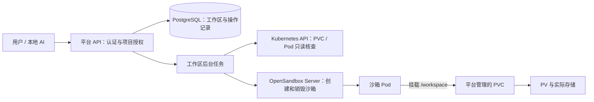
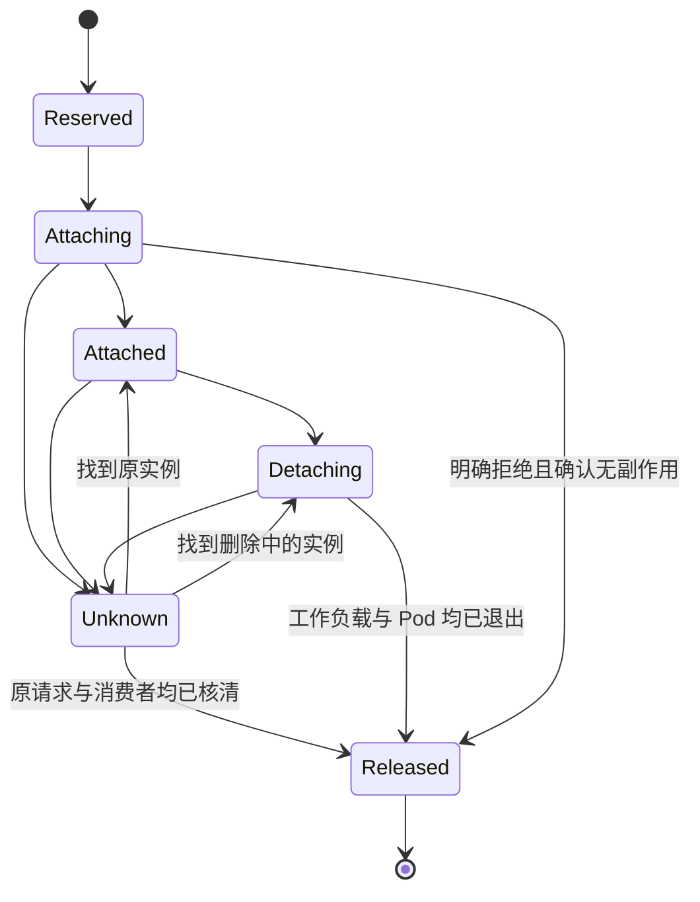

# PVC 持久化工作区设计与开发方案

日期：2026-11-04。状态：设计已确认；第一阶段已实现，范围见 [交付说明](workspace-phase1.md)。适用项目：OlixOps Sandbox Platform。

补充阅读：[用户、对话与工作区产品草案](workspace-product-draft.md) 和 [成熟产品调研](workspace-market-research.md)。产品草案补充了对话引用、归档、长期保留和执行上下文规则；需用户确认后再开发。闲置、停止和归档不触发自动删除，7 天保留仅针对主动进入回收站的数据。

## 1. 目标和第一版结论

把代码的保存周期和沙箱的运行周期分开。用户拥有一个长期保留的工作区，每次需要运行代码时创建沙箱并挂载它。沙箱销毁、TTL 到期或重建时，工作区和 PVC 都继续保留。

推荐第一版采用：**一个工作区对应一个 PVC；一个工作区同时只允许一个沙箱占用；固定挂载到 `/workspace`；PVC 由平台创建和管理；OpenSandbox 只挂载已有 PVC。**

工作区归属“项目 + 用户”，沿用现有项目权限。第一版固定一个 OpenSandbox 后端、一个目标集群和一个沙箱 Namespace；保存集群标识是为了避免资源定位错误，不代表已经支持多集群调度。

本次只产出方案，不执行数据库迁移、不创建 PVC、不改集群，也不把本文中的状态和接口当作已经上线的功能。

## 2. 当前基础和待核对事实

| 已有依据 | 对设计的影响 |
|---|---|
| 平台已有项目成员、沙箱 owner、生命周期、配额、审计和后台核对 | 复用身份和授权，不再建设一套工作区登录体系 |
| 当前 `Platform.Create` 没有传入 `Volumes` | 需要扩展创建请求、数据库关联和 SDK 适配 |
| 当前 Go SDK 固定 v1.2.0，有 `Volume`、`PVC.ClaimName` 等结构 | SDK 能表达挂载，但不能据此推断旧 Server 支持所有新字段 |
| 学习项目 `step10_persistent_volume.py` 使用 context `poc-cluster`、Namespace `opensandbox`、StorageClass `local-path` | 可作为第一轮联调参考，不能当作本次实时集群检查结果 |
| 学习脚本记录过 `WaitForFirstConsumer`、`Delete` 回收策略 | 必须处理首次等待消费者和误删 PVC 的数据风险 |

开发开始前只读确认：实际 kube context/API Server 身份、沙箱真正所在 Namespace、StorageClass provisioner、绑定模式、回收策略、容量限制能力、节点亲和性、目标 Server/Controller 对已有 PVC 的支持。禁止依赖开发者当前默认 kube context。

OpenSandbox 已有卷支持提案说明 PVC 与沙箱 Pod 应处于同一 Namespace，并将命名卷生命周期与沙箱运行分离；实现仍以实际部署版本联调为准。[OpenSandbox 卷设计](https://github.com/opensandbox-group/OpenSandbox/blob/main/oseps/0003-volume-and-volumebinding-support.md)

## 3. 使用场景和边界

| 场景 | 用户动作 | 预期结果 |
|---|---|---|
| AI 连续开发 | 创建工作区，上传代码，启动沙箱运行和修改 | `/workspace` 中的源码、锁文件、输出文件保存在同一个 PVC |
| 下班释放资源 | 销毁沙箱，第二天从工作区重新启动 | 不占运行 CPU/内存；代码保留，存储继续占用配额 |
| 沙箱到期 | TTL 自动清理实例 | 平台核对并解除占用；工作区仍可启动新实例 |
| 进程或环境损坏 | 销毁原实例，再选相同工作区启动 | 恢复文件，不恢复原进程、内存或监听端口 |
| 更换镜像 | 原实例完全退出后选择新镜像启动 | 源码保留；原虚拟环境和二进制依赖可能不兼容 |
| 管理员协助排障 | owner/maintainer 操作所属项目用户的工作区 | 可管理，但不修改工作区 owner，不默认共享给其他普通成员 |
| 放弃项目数据 | 工作区移入回收站，保留期后清除 | 可恢复期内 PVC 仍在；物理清除后恢复依赖外部备份 |

第一版不做：多人同时写同一工作区、跨集群迁移、工作区复制/快照、在线扩容、离线文件浏览、共享模型卷、自动依赖恢复、镜像构建发布、运行进程快照。

持久化范围固定为 `/workspace`。推荐目录：`src/` 保存代码，`data/` 保存业务数据，`artifacts/` 保存输出，`.cache/` 保存可清理缓存。`.venv/` 可以保存，但不承诺跨镜像或架构可用。

`pip install` 到系统目录、`apt install`、`/tmp` 文件、环境变量和后台进程不因挂载 PVC 自动保留。需要复现的依赖写入 `requirements.txt`、锁文件或 Dockerfile。挂载会遮住镜像原有 `/workspace` 内容，不能把镜像中的同路径文件当成自动初始化模板。

## 4. 资源关系与职责



- Workspace 是业务资源，保存归属、容量、状态、保留策略及 PVC 身份。
- Sandbox 是计算资源，保存镜像、TTL、运行状态和可选 `workspaceId`。现有无工作区沙箱继续可用。
- PVC 是存储申请，由平台通过 Kubernetes Go client 创建；底层 provisioner 动态提供 PV。平台第一版不手工创建或修改 PV。
- Attachment 是独占使用记录，覆盖预留、创建、运行、退出及不确定结果；不是 CSI VolumeAttachment 对象。
- Operation 是持久任务，承接跨 PostgreSQL、Kubernetes、OpenSandbox 的非原子操作。

工作区生命周期不由沙箱拥有。PVC 不设置指向沙箱 Pod/BatchSandbox 的 ownerReference，不启用随沙箱销毁删除 PVC 的选项。用户不能提交任意 PVC 名、hostPath、Namespace、StorageClass 或挂载路径。

## 5. 存储选型与容量策略

第一版建议先使用已测试过的 `local-path` 做开发环境验证；公司共享环境需要单独评估现有 CSI 存储。工作区管理模型不绑定某个驱动，存储配置由管理员模板提供。

| 选择 | 适用方式 | 本方案的约束 |
|---|---|---|
| local-path | 单节点或允许节点故障导致不可用的测试环境 | 遵守 PV 节点亲和性；节点不可用时保留原卷，不能创建空卷冒充恢复 |
| CSI 块存储 RWO | 独占开发工作区 | 核查拓扑、挂载/卸载和容量能力，串行切换消费者 |
| CSI RWOP | 驱动和集群满足条件时增强单 Pod 约束 | 需要实际支持，不能直接替换现有 local-path 配置 |
| NFS/CephFS 等 RWX | 后续共享数据或协作场景 | 第一版仍保持平台单消费者规则，不开放多人并发写 |

RWO 表示单节点读写，不能用来保证单 Pod 独占；RWOP 才是单 Pod 访问约束，且要求 CSI 支持。[Kubernetes 访问模式](https://kubernetes.io/docs/concepts/storage/persistent-volumes/#access-modes)

建议初始模板为每工作区申请 `10Gi`、每项目最多 5 个工作区、累计申请不超过 `50Gi`。这些是待落地的配置默认建议，不是当前平台值。现有沙箱运行数量配额和存储配额分别计算；回收站、不确定状态和删除中资源仍占存储配额。

`local-path-provisioner` 官方说明其容量限制并非已经实现的硬隔离。因此申请 `10Gi` 不能宣传为最多只能写 `10Gi`；第一版将申请配额和实际磁盘用量分开显示，无法采集用量时显示“未知”，并配置节点磁盘告警。[local-path 官方说明](https://github.com/rancher/local-path-provisioner)

PVC 存在、PV 保留和备份是三个不同问题。删除 PVC 后，动态 PV 按回收策略处理；`Retain` 也不等于自动备份或自动恢复。平台不修改集群默认 StorageClass；如要降低物理误删风险，由管理员提供专用 Retain 存储模板并定义后续 PV 清理流程。[回收策略](https://kubernetes.io/docs/concepts/storage/persistent-volumes/#reclaiming)

## 6. 状态模型：分开表达业务、存储和占用

只给工作区一个 Running/Stopped 字段会混淆存储和计算。建议分别存储下面三组状态，前端组合展示，并附最后核对时间、reason 和 message。

### 6.1 工作区生命周期 `state`

| 状态 | 含义 | 是否允许启动沙箱 |
|---|---|---|
| Creating | 业务记录已创建，PVC 尚在确认 | 否 |
| Available | PVC 身份已确认，未回收；存储可以 Bound 或等待首消费者 | 无占用且无阻塞 condition 时允许 |
| Trashed | 在回收站，PVC 保留 | 否，先恢复 |
| Deleting | 已不可逆提交物理删除，等待资源消失 | 否 |
| Deleted | 原 PVC UID 已确认消失，保留业务墓碑 | 否 |
| Error | 明确异常，如 PVC Lost、身份冲突、外部删除 | 否，需排查 |

生命周期主路径：`Creating → Available → Trashed → Deleting → Deleted`；保留期内 `Trashed → Available`。Creating 的超时通过 condition 标成 Unknown 并核查，不直接当作创建失败或释放配额。Error 恢复需确认同一 PVC UID，不能默默建空 PVC。

### 6.2 观察到的存储状态 `storagePhase`

| 状态 | 含义与处理 |
|---|---|
| Unknown | 集群不可达或尚未完成读取；阻止新的挂载和删除决策 |
| Pending | PVC 已存在；结合绑定模式和 Events 区分正常等待或异常 |
| Bound | PVC 绑定了 PV；不表示应用一定可读写 |
| Lost | PVC 失去对应卷；工作区 Error，保留现场 |
| Missing | 预期 PVC 不存在；已申请删除时可完成，否则 Error |
| Terminating | PVC 带 deletionTimestamp；阻止新挂载，不强删 finalizer |

`WaitForFirstConsumer` 会将供应或绑定推迟到消费者 Pod 出现。平台在 PVC 处于正常 Pending、绑定模式匹配且身份已确认时即可进入 Available，并允许启动第一个沙箱；不能要求先 Bound 再创建 Pod，否则会互相等待。Immediate Pending 超过操作阈值应报告供给问题。[StorageClass 绑定模式](https://kubernetes.io/docs/concepts/storage/storage-classes/#volume-binding-mode)

### 6.3 挂载记录状态 `attachment.state`

| 状态 | 进入条件 | 退出条件 |
|---|---|---|
| Reserved | 数据库事务抢到工作区独占名额 | 持久任务开始请求远端 |
| Attaching | 创建请求已准备或发出 | 远端资源可确认，转 Attached；结果不明转 Unknown |
| Attached | 沙箱运行且 Pod 的 PVC 引用已验证 | 销毁/到期进入 Detaching；观察不明进入 Unknown |
| Detaching | 实例正在删除或退出 | 远端工作负载已消失且旧 Pod 已消失，转 Released |
| Unknown | 创建/删除/集群观察存在不确定结果 | 核查后回到已证实的状态，不能仅靠超时解锁 |
| Released | 已确认没有旧消费者 | 历史终态，可以预留新挂载 |



前端文案示例：“等待首次使用”“可启动”“正在挂载”“使用中”“正在释放”“状态待核查”“回收站”“删除中”“存储异常”。“使用中”也可能对应沙箱启动阶段，不表示应用已经健康。

应用健康检查、卷可写检查和沙箱 Running 各自独立。首次成功挂载可写入测试文件核验；页面展示最近检查结果，但不得仅凭一个可被 AI 修改的标记文件判断资源身份或权限。

## 7. 关键操作流程

### 7.1 创建工作区

1. 后端识别用户，检查项目成员、数量及申请容量配额；服务端选择存储模板。
2. 同一事务锁定项目，写入 Workspace Creating、幂等请求、Operation 和审计；提交后异步执行。
3. 生成不可预测且稳定的 PVC 名，例如 `olx-ws-<workspace-id>`，附平台、workspaceId、projectId 标签。
4. 调用 Kubernetes API 创建 PVC。AlreadyExists 时核对归属、配置和 UID，不能只凭名称直接接管。
5. 持久化 PVC UID；按实际 Pending/Bound 状态更新 Available 或 condition。
6. 超时则按原名字查询；不随机更名重试，不将不确定资源遗留在库外。

创建请求应返回 202 和可查询操作；重复幂等键和相同参数返回原对象，参数改变返回 409。

### 7.2 从工作区启动沙箱

1. 请求只传 `workspaceId`、允许的镜像、TTL、requestKey；现有不挂载工作区方式保持兼容。
2. 校验工作区、项目及所有者；普通成员不能使用别人的工作区。
3. 按固定锁顺序锁定项目和工作区；同一事务预留沙箱计算配额、写沙箱记录、独占 Attachment 和 Operation。
4. 检查 PVC UID 未改变、没有 deletionTimestamp、没有无法解释的其他消费者；不允许工作区处于回收站或删除中。
5. 使用已有 PVC 创建沙箱：`Volume{Name: "workspace", PVC: &PVC{ClaimName: storedName}, MountPath: "/workspace"}`。默认省略版本敏感的自动供应/自动删除字段，不向旧 Server 传未验证字段。
6. 沿用 operationId，并增加 workspaceId 元数据以便核查；UID 等可信映射保存在平台数据库。
7. 确认实际 Pod 引用了预期 PVC，实例运行后更新 Attachment；再检查 `/workspace` 可读写。
8. 如果创建超时，保留独占和计算配额进入 Unknown，按原 operationId 核对；不允许立即启动第二个沙箱。

工作区管理员替用户启动时，新沙箱的 owner 必须保持为工作区 owner，审计 actor 仍为实际操作者。第一版不提供“把别人的工作区挂到我自己的沙箱”，防止权限范围被隐式转移。

### 7.3 销毁、TTL 到期与重建

1. 用户销毁沙箱只改变计算实例，不删除 PVC，不自动进入回收站。
2. 先记录 Detaching，再调用 OpenSandbox 生命周期 API 删除；禁止直接删 Pod 代替删除受控工作负载。
3. 即使 API 返回成功/404 或数据库已记 Deleted，也要确认对应工作负载不会重新创建 Pod、旧消费者 Pod 已退出；CSI 后续仍可能需要卸载时间。
4. 确认清理后才写 Released。新建实例由同一 PVC/PV 的拓扑约束调度，挂载失败则保留卷并展示原因。
5. TTL 到期、用户主动销毁、运行失败都走同一个核对逻辑；不能直接套用当前 `domain.Terminal` 判断来释放挂载。

**现有 `SyncOne` 在删除接口成功后就更新 Deleted，这对展示计算状态可以沿用，但不足以证明挂载可以复用，需要增加独立的消费者退出核验。**

### 7.4 回收站、恢复与物理清除

建议回收站默认保留 7 天，属于新功能配置建议。移入回收站前必须没有未释放 Attachment 和其他 Pod 消费者；占用中返回 409，引导先销毁实例。保留期内不删除 PVC，恢复只改变业务状态。

到期任务重新持锁检查：仍是 Trashed、保留期到达、PVC UID 匹配、无消费者，才原子转 Deleting 并提交删除任务。恢复操作和清除操作只能有一方成功；进入 Deleting 后不再允许恢复。

删除 PVC 使用 UID precondition，防止同名重建误删；删除超时继续按原 UID 核对。被 pvc-protection 等保护阻塞时显示原因，不自动移除 finalizer。PVC 消失只表示业务删除完成，底层 Retain PV 需要运维另行清理；保留物理清理状态，不宣传所有磁盘空间已释放。

第一版不提供立即强制清除入口；页面必须明确区分“销毁沙箱”“移入回收站”“永久删除数据”。误删恢复依赖保留期或已验证的备份，不承诺恢复已物理清除的数据。

## 8. 权限与 Kubernetes 凭据

| 操作 | member | 项目 owner/maintainer | 平台 admin |
|---|---|---|---|
| 创建工作区 | 归属自己 | 归属自己 | 按显式运维流程 |
| 查看、启动、移入回收站、恢复 | 自己的工作区 | 同项目工作区 | 已授权范围 |
| 修改工作区 owner / 任意导入 PVC | 不允许 | 不允许 | 第一版也不开放通用接口 |
| 物理清除 | 无直接入口 | 无直接入口 | 由受控后台任务执行 |
| 选择存储驱动、Namespace、路径 | 不允许 | 不允许 | 通过服务端部署配置 |

无权访问返回 404；先做资源授权，再联系 Kubernetes 或 OpenSandbox。owner 失去项目成员资格或账号停用后，原工作区数据保留，由项目管理者处理，不自动删除。授权移除不保证已经运行的进程停止，后续离职流程需单独处理运行实例。

Go 后端使用 `client-go`，生产使用专用 ServiceAccount 的 InClusterConfig；本地使用显式 kubeconfig 文件和 context，启动时核对目标集群身份与 OpenSandbox 后端映射。

目标 Namespace 的 Role 建议只授予 PVC `get/list/watch/create/delete`、Pod `get/list/watch`、Events `get/list/watch` 及实际工作负载 CR `get/list/watch`。第一版不授予 Secrets、Pod exec、Pod 创建/删除、PV 写权限或 cluster-admin。读取 StorageClass 的权限仅在需要动态核验时通过单独只读 ClusterRole 提供，否则由运维预检并固定模板。

Kubernetes 原生 RBAC 不能按平台标签限制 create/delete 范围。共享 Namespace 内该账号的 PVC 权限可能覆盖非平台 PVC，因此应用检查不是完整的基础设施隔离。PoC 需确认 Namespace 边界；正式部署应采用专用沙箱 Namespace，并评估 admission policy/独立供应服务。OpenSandbox 能否选择该 Namespace 要先验证，不能直接假定支持按用户 Namespace。

## 9. 数据模型草案

以下仅为新增迁移的设计，不是当前实际 schema。不修改现有 `design/database.md` 的“已实现”描述；进入开发时新增 `003_persistent_workspaces.sql`，同时同步内嵌 SQL、数据库文档和 OpenAPI。

| 对象 | 关键字段 | 约束 |
|---|---|---|
| workspaces | id、project_id、owner_id、name、state、cluster_id、namespace、pvc_name、pvc_uid、storage_class、requested_bytes、storage_phase、conditions、last_observed_at、trash_at、purge_after、version、request_key | project/owner/request_key 唯一；cluster/namespace/pvc_name 唯一；PVC UID 不能无声替换 |
| workspace_attachments | id、workspace_id、sandbox_id、state、generation、released_at、reason、last_observed_at | 一个工作区和一个沙箱都只能有一个未释放挂载 |
| workspace_operations | id、workspace_id、sandbox_id、kind、state、request_key、request_hash、attempt、next_attempt_at、lease_owner、lease_until、generation、error_code | 请求幂等；任务持久化；租约过期可接管，但不等于资源使用锁过期 |
| sandboxes 扩展 | 可空 workspace_id、attachment_id | 历史沙箱仍为空；有关联的 owner/project 必须与工作区匹配 |
| projects 扩展 | workspace_quota、storage_quota_bytes | 配额变更由后端配置或受控管理员流程提供 |
| audit_events 扩展 | workspace_id、operation_id、resource_type | 工作区操作不伪装为 sandbox_id；现有审计仍兼容 |

每个新表都包含 `create_at/update_at/create_by/update_by`。资源关联使用外键与复合归属约束；墓碑和历史挂载不级联删除。工作区状态、存储状态和 reason 使用有定义的枚举/条件；禁止只存自由文本作为决策依据。

关键索引草案：

```sql
-- 拟议 DDL，开发时纳入完整迁移，而非直接执行本文片段。
CREATE UNIQUE INDEX workspace_one_active_attachment
ON workspace_attachments(workspace_id) WHERE released_at IS NULL;
CREATE UNIQUE INDEX sandbox_one_active_workspace
ON workspace_attachments(sandbox_id) WHERE released_at IS NULL;
CREATE INDEX workspace_operation_due
ON workspace_operations(next_attempt_at) WHERE state IN ('Pending', 'Retry');
CREATE INDEX workspace_purge_due
ON workspaces(purge_after) WHERE state = 'Trashed';
```

使用 `released_at IS NULL` 保证 Unknown、Error 等新增状态不会意外绕过独占约束。成功释放必须同时设置 Released 和 released_at；任务与资源状态更新须校验 generation/version，防止旧 worker 覆盖新观察结果。

## 10. 接口和页面设计

沿用 `/api/v1`、GET/POST、Bearer 认证及 `{code,msg,data}` 规范。建议新增：

| 接口 | 请求与用途 |
|---|---|
| POST `/api/v1/workspace/list` | projectId，带分页；普通成员只看到自己的 |
| POST `/api/v1/workspace/create` | projectId、name、storageTemplate、requestKey；大小由模板约束 |
| POST `/api/v1/workspace/detail` | workspaceId；返回三组状态、当前占用和脱敏诊断 |
| POST `/api/v1/workspace/action` | workspaceId、action=sync/trash/restore、requestKey；不接受任意资源字段 |
| POST `/api/v1/workspace/operation` | operationId；返回任务状态、可重试原因及下一步 |
| 现有 `/api/v1/sandbox/create` 扩展 | 可选 workspaceId；使用服务端 PVC 映射 |

创建和回收操作采用异步 202；抢占冲突/状态不允许返回 409，参数错误 400，无权或不存在 404；body.code/msg 与 HTTP 状态及项目规范一致。公开诊断不返回 kubeconfig、Token、主机目录或敏感事件正文。

前端新增“持久化工作区”导航、列表、创建弹窗、详情、回收站及操作状态。列出名称、归属、申请容量、存储状态、占用沙箱、最近核对时间；无法取得实际用量时不能以申请容量冒充已用容量。

沙箱创建弹窗允许“临时沙箱 / 挂载已有工作区”；详情显示 `/workspace` 和工作区关联。工作区提供“启动沙箱 / 查看当前沙箱 / 移入回收站 / 恢复”按钮，按状态和权限控制。空闲工作区第一版不能直接读文件，提示先启动沙箱。

## 11. 后台核对和失败恢复

采用持久 Operation + PostgreSQL 行锁/`SKIP LOCKED` 任务领取；短事务预留，外部 API 调用在事务外执行。Operation 写入和业务预留在同一事务，避免进程退出后遗失任务。多副本通过租约领取，generation 防止过期 worker 回写。

所有外部动作在执行前再次确认期望状态与资源 UID；清除进入不可恢复 Deleting 状态后才能发起 PVC 删除。worker 租约负责调度，不负责宣告卷已空闲；即使 worker 崩溃也必须保留未释放 Attachment。

OpenSandbox 创建不假定支持服务端幂等。发送前先原子写入 dispatch_intent；接管者发现已经有发送意图时只核查原 operationId，不再次发起 create。即使原 worker 尚未来得及发出请求，这个状态也宁可保留 Unknown，不能用租约到期推断请求没发出。数据库 generation 只能防止旧结果回写，不能阻止已经在途的外部副作用；未查清的发送意图始终阻止第二个消费者。

| 故障 | 处理原则 |
|---|---|
| Kubernetes 创建 PVC 超时 | 用稳定名字与标签核查，不另建一个 |
| PVC 成功、数据库更新失败 | 原任务继续接管并记录 UID；对象身份不能匹配时转人工核查 |
| Server 创建沙箱超时 | 保留 Unknown 和独占，按 operationId 查远端；不自动重放创建 |
| 数据库 Failed/Expired，但 Pod 仍存在 | 不释放挂载，展示仍有消费者 |
| Server 返回 404，集群不可达 | 不能证明消费者消失，保持 Detaching/Unknown |
| PVC 同名重建、UID 不同 | 阻断挂载和删除，Error；不自动认领 |
| PVC 被外部删除 | Error + 告警，禁止新建空 PVC 冒充数据恢复 |
| local-path 所在节点故障 | 保留卷，展示拓扑/节点原因；不宣称能迁移到其他节点继续读取 |
| 磁盘满、目录无写权限 | 区分存储状态与写检查结果，提供诊断；不删除数据或无限重启 |
| PVC 删除长时间 Terminating | 检查消费者与保护机制，保留任务，不移除 finalizer |
| 回收站恢复与到期清除并发 | 同一资源锁及版本约束，只有一个状态迁移成功 |

建议首版每 15 秒核对，失败采用退避与抖动；创建或释放 3 分钟未完成标记 LongPending 条件并提示检查。时间阈值只用于告警和重试调度，不作为自动释放资源锁或删除数据的证据。无法消除歧义时由受控运维流程处理，普通用户没有“强制解锁”按钮。

## 12. 开发任务与代码落点

| 阶段 | 需要做的事情 | 主要落点 | 完成标准 |
|---|---|---|---|
| P0 兼容性验证 | 只读核对集群、Namespace、SC；验证已有 PVC 挂载、Pending 首消费者、销毁保留 | 开发预检脚本、联调记录 | 固定验证过的 Server/Controller/SDK 与存储组合 |
| P1 数据与权限 | 模型、迁移、配额、归属、幂等、独占索引、审计扩展 | `internal/domain`、`infrastructure/store`、`migrations` | 并发与越权集成测试通过 |
| P2 存储适配 | client-go、显式 context、PVC create/get/delete、UID、消费者/CR/Events 读取、RBAC | 新增 `internal/infrastructure/storage`、`configs`、`deploy` | 不依赖默认 context，无 PV 写权限 |
| P3 生命周期编排 | 持久任务、工作区创建、卷挂载、Unknown 恢复、退出核验、回收站、删除 | `internal/application`、后台 worker、sandbox 适配 | A 实例删除后 B 可读取原数据，歧义不解锁 |
| P4 API 和页面 | handlers、OpenAPI、工作区页面、沙箱创建扩展、诊断及删除文案 | `internal/interfaces`、`api/openapi.json`、`web/src` | 完整用户流程可操作，无任意 PVC 输入 |
| P5 验收与部署 | 真实集群测试、重启恢复、多副本竞争、运维说明、配置模板 | 测试、`scripts`、`design`、`deploy` | 验收清单通过，权限及数据保留结果可回查 |

P0 先产出兼容性结论；P1～P3 打通后再接页面。不要只给创建接口增加 `volumes` 就宣布持久工作区完成，因为独占、回收、权限和异常恢复同样属于交付内容。

文档更新：数据库设计、持久化方案、权限矩阵、OpenAPI、roadmap、README 和验收记录。现有临时沙箱、登录、命令和文件流程必须回归；本方案不要求提前引入 Redis 或部署独立队列服务。

## 13. 验收用例

| 类别 | 必须验证的结果 |
|---|---|
| 持久化主流程 | A 挂载写入代码和中文文件并计算 SHA256；销毁 A；核验原 PVC UID 不变；B 挂载原工作区，哈希一致并可启动应用 |
| TTL 清理 | A 自动过期，PVC 仍存在；工作负载/Pod 消失后自动解锁；B 读取成功 |
| 首次绑定 | WFFC Pending 可以创建首消费者；无“先 Bound 才能启动”的死锁 |
| 并发 | 同一工作区并发启动只有一个预留成功，其他 409；不同后端副本竞争也成立 |
| 权限 | A 不能列出/读取/挂载/回收/恢复 B 的工作区；跨项目、伪造 owner/PVC 参数无效 |
| 幂等及故障 | 创建 PVC/沙箱超时、进程退出和 DB 更新失败后不重复创建，不丢独占 |
| 销毁判定 | 删除 API 成功但旧 Pod 未退出时不能再次挂载；CR 仍可重建 Pod 时不能误判空闲 |
| 外部漂移 | PVC 丢失、同名不同 UID、意外消费者时阻断敏感操作 |
| 回收站 | 保留期内恢复读到原文件；占用中不可回收；恢复/清除竞争不会误删 |
| 删除 | UID precondition 生效；删除失败保留任务；PVC 保护不强拆；Retain/ Delete 的底层结果分别记录 |
| 重启与多副本 | 平台重启不丢任务/挂载锁；过期 worker 不能覆盖新状态；不因租约过期直接解锁 |
| 配额 | 空闲/回收站仍计存储配额；运行计算单独计算；并发不能突破配额 |
| 环境 | 同镜像 UID/GID 下可写；换镜像权限不符有清晰诊断；节点不可用不会静默分配空卷 |

测试层次：纯状态与授权测试、真实 PostgreSQL 集成测试、模拟 Kubernetes/Server 失败、指定 PoC 集群端到端测试。运行 `go test -race`、`go vet`、后端构建、前端类型检查和构建。真实测试只清理自己创建的资源；涉及物理删数据的用例只使用独立测试工作区。

## 14. 上线顺序和后续演进

先通过 feature flag 对测试项目开放，保留原临时沙箱模式；再观察 Pending、Unknown、挂载耗时、磁盘用量和回收站积压后扩展到公司用户。开关关闭只阻止新增，不停止已有工作区的核对与保留。

第一版交付边界是：**代码长期保留、计算可销毁重建、权限与独占可验证、删除有明确流程**。在此基础上再做备份恢复演练、存储用量采集、扩容、快照克隆、共享只读数据卷和隔离镜像构建。

发布链路从指定代码版本或受控快照生成镜像；不能把“PVC 文件保留”当作“镜像可复现发布”。预热池/Pool 和请求级卷挂载的组合需按目标版本单独验证，第一版不混用。

## 15. 参考资料与本地依据

- [OpenSandbox 卷支持设计](https://github.com/opensandbox-group/OpenSandbox/blob/main/oseps/0003-volume-and-volumebinding-support.md)：资源映射与卷模型；设计提案不代表部署版本全部实现。
- [OpenSandbox Go SDK](https://github.com/alibaba/OpenSandbox/tree/main/sdks/sandbox/go)：实现时优先查看项目锁定的 v1.2.0 源码，而非直接照抄 main 新字段。
- [Kubernetes Persistent Volumes](https://kubernetes.io/docs/concepts/storage/persistent-volumes/)：PVC/PV、访问模式、保护与回收。
- [Kubernetes StorageClass](https://kubernetes.io/docs/concepts/storage/storage-classes/)：动态供应与绑定模式。
- [local-path-provisioner](https://github.com/rancher/local-path-provisioner)：当前测试存储的行为和容量边界。
- [Kubernetes RBAC](https://kubernetes.io/docs/reference/access-authn-authz/rbac/)：Namespace Role 与资源权限。
- 本地依据：当前项目 `internal/application/platform.go`、`internal/domain/models.go`、`design/security.md`、`design/roadmap.md`；学习项目 `/Users/vincent/opensandbox-demo/step10_persistent_volume.py` 和 `opensandbox-workspace-pvc.yaml`。

后续开发前需落定：真实目标 context/Namespace、可用 StorageClass、容量模板和保留期、生产备份责任人、实际工作负载 CR 的发现方式、已有 PVC 在目标版本下的挂载行为。本文默认值是建议，不是用户已确认的生产策略。
