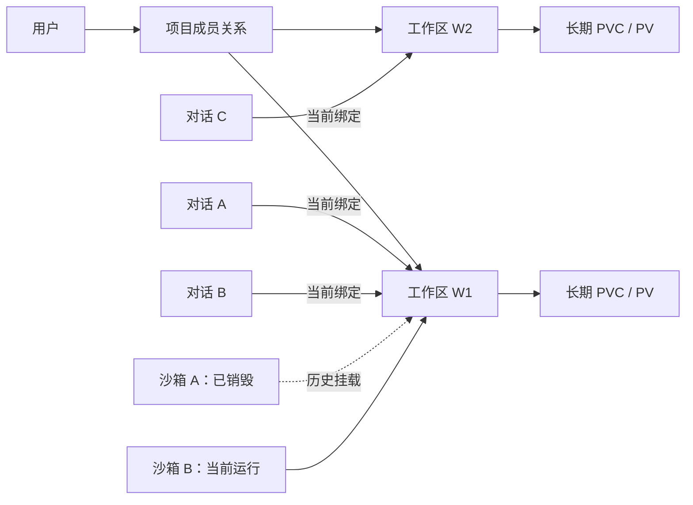
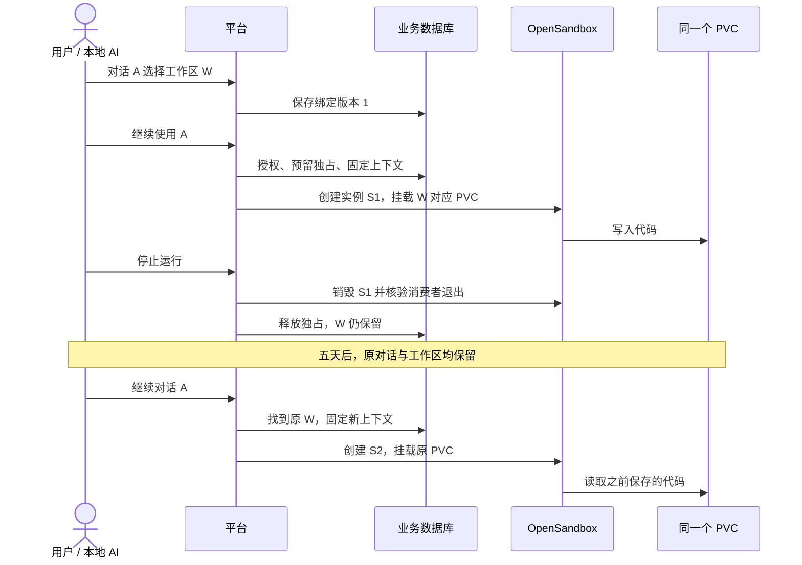

# 用户、对话与持久工作区：产品设计草案

日期：2026-11-04。版本：草案 v0.2。状态：用户已确认推荐规则；新增个人逻辑 Namespace，第一阶段实现见 [交付说明](workspace-phase1.md)。其余内容仍是后续范围。

本文补充并约束 [PVC 技术方案](persistent-workspace-plan.md)。用户界面和生命周期语义以本文为准；卷供应、任务恢复和集群适配沿用技术方案。本文保留产品设计；实际已交付与待做边界以第一阶段交付说明为准。

## 1. 结论与设计目标

推荐采用 **用户拥有工作区、对话引用工作区、运行实例临时挂载工作区** 的模型。

用户在平台管理“工作区”，不需要直接管理 PV。每个工作区对应平台控制的 PVC，正常销毁和重建沙箱时复用原 PVC/PV。更换镜像、关闭应用、TTL 到期、对话结束、归档或闲置数天，都不应删除这个工作区。

工作区 ID 是长期业务身份。PVC UID 是底层对象身份校验；PV 是当前实际存储。未来经过明确的数据迁移操作，PV 可以变化，平台仍以原工作区代表同一份逻辑数据。不得将“永远保留”解释为节点磁盘损坏后也不需要备份。

期望的用户体验：今天让本地 AI 上传代码并运行，结束时停止计算；五天后继续原对话，平台定位到原工作区，启动或复用运行实例，读取之前的代码，再执行新的开发任务。

## 2. 市场参考与取舍依据

完整调研见 [成熟产品官方资料对比](workspace-market-research.md)。以下仅列直接影响本方案的依据。

| 参考对象 | 已核实的官方行为 | 本平台采用什么 | 不直接照搬什么 |
|---|---|---|---|
| JupyterHub on Kubernetes | 每个用户有自己的 PVC；用户服务器 Pod 删除后 PVC/PV 保留，再次启动重用 | 用户数据和 Pod 分离、原卷复用 | “一用户一个主目录”扩展为“一用户多个工作区” |
| Coder | 模板可保留卷、停止时销毁临时计算；持久资源名称应使用不可变 ID | 工作区长存、计算可重建；资源名称使用工作区 ID | 不引入 Terraform 控制层，也不将重命名与存储重建绑定 |
| GitHub Codespaces | 可以停止后重启；停止后仍有存储占用，并存在可配置保留期 | 停止与删除分离、显示存储占用 | 不采用默认闲置删除：用户要求隔数天还能继续 |
| Daytona | 卷是独立资源，可跨沙箱使用 | 卷生命周期独立于单次沙箱 | 不照搬其底层存储和多消费者一致性实现 |

直接来源：[JupyterHub 用户存储](https://z2jh.jupyter.org/en/stable/jupyterhub/customizing/user-storage.html)、[Coder 资源持久化](https://coder.com/docs/admin/templates/extending-templates/resource-persistence/)、[Codespaces 生命周期](https://docs.github.com/en/codespaces/about-codespaces/understanding-the-codespace-lifecycle)、[Daytona Volumes](https://www.daytona.io/docs/en/volumes/)。产品版本、状态和其他来源以调研文件的核查记录为准。

对话持久化另作参考：LangGraph 用线程范围的 checkpoint 保存运行/对话状态，同时区分跨线程数据存储。这说明对话连续性和代码文件保留是不同问题，不表示 LangGraph 已替我们实现 PVC 管理或文件回滚。[LangGraph Persistence](https://docs.langchain.com/oss/python/langgraph/persistence)

**推导与自定义部分：**一对话一个当前工作区、多对话复用同一工作区、回收站、运行上下文固定等，是结合本地 AI 接入需求制定的规则，不能说成上述产品的通用现成功能。本次参考用于验证设计方向，不等于已经验证当前集群实现。

## 3. 业务对象和关系

| 对象 | 含义 | 生命周期及归属 |
|---|---|---|
| User | 平台用户，以不可变 userId 识别 | 本地认证，后续接公司 IdP；改显示名不改变存储 |
| Project | 权限、配额和审计边界 | 工作区不能跨项目直接挂载 |
| Workspace | 一份长期保存的开发文件 | 属于一个项目和一个用户；一用户可以有多个 |
| ConversationRef | 外部 AI 对话的引用，不是完整聊天系统 | 属于一个项目和一个用户；保存来源和外部对话 ID |
| ConversationBinding | 对话当前使用的工作区及历史 | 对话最多一个当前绑定；一个工作区可被多个对话引用 |
| Sandbox / Runtime | 临时计算实例，实际执行代码 | 一个工作区同时最多一个未释放的挂载；历史实例可以很多 |
| RunContext | 一次获准执行的上下文 | 固定当时的对话、工作区、绑定版本、实例和操作者 |

对话不是工作区的所有者，不做 `conversation → workspace → PVC` 的级联删除。平台登录 Session 也不是 Conversation：退出登录既不删文件，也不自动停止已经启动的任务。

## 4. 绑定规则

### 4.1 用户与工作区

新建工作区时，由后端从登录身份写入 ownerId。普通用户只管理自己的资源；项目 owner/maintainer 沿用现有项目管理权限。配额同时限制工作区数量和申请容量，运行实例数量另行限制。

第一版不转让 owner、不导入任意已有 PVC、不挂载他人目录、不跨集群移动工作区。项目管理者协助启动时，实例 owner 仍是工作区 owner，audit actor 是实际操作者。

### 4.2 对话与工作区

- 首次使用对话时，用户选择“创建新工作区”或“使用已有工作区”。没有绑定时不静默选择最近使用的目录。
- 一个对话同一时刻只能绑定一个工作区；同一用户的多个对话可以引用同一工作区。
- 默认绑定后保持不变。更换工作区必须显式选择并确认，同时保存绑定历史和递增版本。
- 引用相同工作区代表共用同一份当前文件，不是独立分支。对话 A 的修改会被对话 B 读到。
- 对话归档、删除或解除绑定只改变引用，不停止计算、不删工作区。停止计算是另一个明确操作。
- 工作区进入回收站后保留对话引用作为历史，继续对话时提示先恢复；永久删除后保留可识别的墓碑，不能自动创建空工作区冒充恢复成功。
- 第一版仅允许绑定同项目、同 owner 的对话与工作区。项目管理者可代为管理，但不能将自己的对话绑定到别人工作区取得隐式共享。

第一版接入的是本地 AI 的对话引用，不在平台实现聊天消息、模型上下文压缩或完整 Agent 编排。聊天内容继续由原客户端保存；如果原客户端不提供稳定对话 ID，就显式保存 workspaceId，不能承诺自动恢复原对话关联。

对话外部键采用 `(integrationId, projectId, ownerId, externalConversationId)`。该 ID 是定位键，绝不是访问凭证。普通客户端提供的 ID 只能登记为该用户自己的引用；接公司统一 AI 平台时，还需验证集成身份及外部对话归属。不得仅凭一个可猜测的 threadId 读取他人绑定。

### 4.3 运行上下文固定与并发

工具执行必须先解析并授权当前绑定，再生成 RunContext，固定 workspaceId、bindingVersion、sandboxId、attachmentGeneration 和 actor。后续文件、命令及日志请求校验该上下文，不随“当前选择”变化而改目标。

有未结束的执行时，第一版禁止切换绑定；迟到的请求带旧版本时拒绝，不执行到新工作区。同一工作区允许多个对话建立引用，但第一版只允许一个主动执行上下文，竞争返回 409，不建设隐式排队。

“一个沙箱挂载”只防止第二个消费者，并不防止同一沙箱内的多个进程同时写文件。平台控制的前台执行在工作区范围串行；用户手工启动的后台服务可能仍在写文件，因此界面必须显示后台执行情况，停止或切换操作不能声称已经解决任意文件并发。真正隔离开发分支应使用独立工作区，未来再做克隆。

第一版 RunContext 仅为平台工具操作提供最小定位和并发控制，不承诺本地 AI 客户端、任意人工命令与外部进程之间的全局事务。

## 5. 用户操作定义

| 操作 | 计算实例 | 工作区文件 | 对话关联 |
|---|---|---|---|
| 新建工作区 | 默认不启动 | 新建独立 PVC | 可以稍后绑定 |
| 绑定对话 | 不自动启动 | 不复制、不修改 | 新建或更新引用 |
| 启动 / 继续使用 | 已运行则返回同实例；无实例则创建 | 挂载原 PVC | 返回固定执行上下文 |
| 停止运行 | 停止任务后销毁实例，等待旧消费者退出 | 保留 | 保留 |
| 重建运行环境 | 旧实例完全退出后用选定镜像创建 | 保留 `/workspace` | 保留，更新 runtime 上下文 |
| 归档工作区 | 要求先停止运行，处理中不允许归档 | 保留，不自动到期 | 保留；继续使用前先取消归档 |
| 取消归档 | 不自动启动 | 保留 | 原引用可继续使用 |
| 删除对话 / 解除绑定 | 无自动影响 | 保留 | 删除引用或标记对话已删除 |
| 删除工作区 | 必须先停止运行 | 进入回收站 | 保留历史并提示不可用 |
| 回收站恢复 | 不自动启动 | 使用原 PVC | 原引用重新可用 |
| 永久清除 | 禁止有消费者 | 保留期后按受控任务删除 | 历史引用显示已删除 |

页面主按钮使用“停止运行”“归档工作区”“删除工作区”，不使用含义不清的“关闭 PV”。停止前提示运行进程将退出；删除前提示数据回收时间以及仍然关联的对话数量。

## 6. 长期保留与删除策略

推荐默认值：工作区闲置不自动删除，归档不自动删除；保留的文件一直计入存储配额。存储不足时阻止新建/扩容，不以静默清理用户旧代码的方式释放容量。

只有用户或有权限的管理者明确点击“删除工作区”，才进入回收站。建议回收站保留 7 天，`purgeAfter` 在该次删除时固定，页面显示实际时间。保留期、工作区数和容量建议均待确认，不是已经启用的策略。

回收站不等于快照：保留的是原 PVC，不会生成副本。恢复和到期清除通过同一资源锁与版本检查竞争；清除进入 Deleting 后不再允许恢复。清除任务使用原 PVC UID，不能误删同名新对象。

移入回收站和永久清除分别记录审计。永久清除只能处理专属测试或明确归属的工作区卷，不扩展到外部 PVC。Node 故障、误操作、底层存储损坏的恢复需要独立备份策略，Git 也不能替代未提交文件和业务数据的备份。

自动停止计算可作为后续按项目配置，但第一版建议只沿用显式 TTL 和手动停止。不能把“没有浏览器点击”当成没有 AI 后台任务。未来加入自动停止时，应显示策略并提供任务活动信号，不与数据保留期限混用。

## 7. 页面草案

### 7.1 我的工作区

项目下新增“持久化工作区”导航，列表提供“全部 / 常用 / 已归档 / 回收站”视图。普通成员只见自己资源，管理者可以切换到项目范围。

列表字段：名称、owner、运行状态、数据状态、申请容量、实际用量或“未知”、关联对话数量、最近使用时间、最近核对时间。申请容量不能冒充实际用量。

主操作：新建、启动/进入、停止运行、详情。归档和删除放入更多菜单；回收站仅提供详情及恢复，清除由后台保留策略处理。正在创建、释放、核查的资源显示原因和操作进度，不能通过按钮重复发起。

### 7.2 新建工作区

字段：名称、项目、受控存储模板；可选创建后启动。owner、PVC 名、Namespace、挂载路径不由用户填写。默认可选择“稍后绑定对话”，避免为了保存文件必须先存在聊天记录。

第一版建议模板：10Gi、固定 `/workspace`、验证过的 StorageClass。实际容量能力与基础设施限制在模板说明中展示。

### 7.3 工作区详情

详情分成“概况”“关联对话”“运行历史”“操作记录”。概况显示数据保留说明、运行实例、镜像、TTL、文件挂载点；存储诊断只在需要时展开。

关联对话只显示平台已登记的引用、来源和最近使用时间。没有集成跳转能力时不伪造“打开原对话”链接。停止运行时文件入口说明“先启动运行环境查看文件”，第一版不创建隐藏浏览 Pod。

### 7.4 对话或本地 AI 工具入口

若调用方有自己的聊天页面，可展示“当前工作区：订单服务 / 已停止”和“继续使用”按钮；否则本平台提供“绑定对话引用”操作，并由工具返回 workspaceId 和运行上下文供客户端保存。

继续使用时先展示原工作区状态；启动完成不自动重放上一次有副作用的命令，也不自动执行未经确认的启动脚本。应用要重新启动时，由用户或 AI 发起新的受控命令。

## 8. 状态设计与典型过程

沿用技术方案中的三个事实维度，不把所有信息揉成一个状态字段：

- 工作区 `state`：Creating / Available / Trashed / Deleting / Deleted / Error。
- 存储 `storagePhase`：Unknown / Pending / Bound / Lost / Missing / Terminating。
- 挂载 `attachment.state`：Reserved / Attaching / Attached / Detaching / Unknown / Released。

新增业务字段 `archivedAt`，归档是组织状态，不新增一种底层存储状态。对话引用使用 Active / Archived / Deleted，绑定另存版本及历史；这些都不触发存储清除。

前端派生运行状态：Stopped / Starting / Running / Stopping / Checking / Error。“可启动”依赖原 PVC 身份已核对、工作区未归档/回收、没有独占占用及阻塞条件。WFFC 正常 Pending 可以进入首次启动流程，不能等待 Bound 才创建消费者。

存储在线不表示应用健康，沙箱 Running 不表示依赖已恢复。需要重现的镜像和依赖单独保存模板信息；日志、内存与进程不是 PVC 自动持久化的对象。

## 9. 数据与接口草案

技术方案已有 workspaces、workspace_attachments、workspace_operations 及 sandboxes 关联。本草案补充：

| 新增对象/字段 | 用途与约束 |
|---|---|
| workspaces.archived_at、last_used_at | 归档和排序；不用作闲置删除依据 |
| conversation_refs | id、integration_id、external_conversation_id、project_id、owner_id、title、state；外部键按集成/项目/用户隔离 |
| conversation_workspace_bindings | id、conversation_id、workspace_id、version、ended_at；每对话一个未结束绑定；保留历史 |
| execution_contexts | id、conversation_id 可空、workspace_id、binding_version、sandbox_id、attachment_generation、actor_id、state、request_key、expires_at |
| workspace_operations 扩展 | start/stop/archive/restore/bind 等审计关联；保存操作参数摘要和版本，防止同幂等键改目标 |

所有新增表保留项目要求的 `create_at/update_at/create_by/update_by`。工作区名、对话标题、用户名不作为 PVC 名或权限主键。对话绑定、挂载和运行上下文都不级联删除工作区。

接口全部使用 GET/POST、统一响应和当前认证，以下都是拟议接口，尚未添加：

| 接口/扩展 | 用途 |
|---|---|
| POST `/api/v1/workspace/create`、`list`、`detail` | 自助管理自己的工作区 |
| POST `/api/v1/workspace/action` | sync / archive / unarchive / trash / restore |
| POST `/api/v1/workspace/runtime/start` | 幂等启动或复用原运行实例，返回异步操作 |
| POST `/api/v1/workspace/runtime/stop` | 幂等停止实例，保留工作区 |
| POST `/api/v1/conversation/register` | 显式登记对话引用；不接收用户自报的他人 owner |
| POST `/api/v1/conversation/workspace` | resolve / bind / unbind；带 expectedVersion 防并发切换 |
| POST `/api/v1/conversation/continue` | 校验引用、启动/复用实例并返回执行上下文 |
| 现有命令/文件接口扩展 | 可选 executionContextId；每次仍校验 actor、资源和版本 |

执行上下文 ID 不等于永久授权，必须与调用者身份、绑定和实例 generation 一起校验。普通成员、管理者代操作、无对话人工操作均使用同样授权入口。运行实例重建后旧上下文失效，不能把迟到的文件请求转发到新实例。

不以数据库事务包住远端创建/删除。异步 Operation、PVC UID、稳定 operationId、独占索引和失败核查沿用技术方案；Unknown 不因超时自动解锁。第一版不因引入对话绑定而建设完整 Agent 调度引擎。

## 10. 开发范围与顺序

| 阶段 | 内容 | 交付判据 |
|---|---|---|
| 设计确认 | 确认本草案规则、容量和保留策略 | 用户明确确认后才进入功能开发 |
| A：持久工作区 | 技术预检、数据迁移、权限配额、PVC 供应、独占、启停、核对恢复 | 无对话也能 A 写入 → 停止 → B 读取 |
| B：自助管理 | 工作区列表/详情、归档、回收站、审计和状态解释 | 用户能管理多个工作区，操作不混淆数据和计算 |
| C：对话关联 | 引用登记、绑定历史、继续使用、最小执行上下文 | 同对话隔天定位原目录，切换/迟到请求不串目录 |
| D：集成验收 | 本地 AI 或公司 AI 平台接入、权限、并发、故障测试 | 跨用户和跨对话行为满足下方清单 |

迁移和接口开发时同步数据库设计、内嵌 SQL、OpenAPI、安全文档和部署 RBAC；不直接执行本文的字段草案。已有临时沙箱模式保留，OIDC、聊天消息存储、自动发布和备份产品化不混入本次范围。

## 11. 验收清单

1. 用户能创建 W1/W2；重命名不改变 PVC UID，不能看到或使用其他普通成员的工作区。
2. W1 写入文件并记录哈希，停止/TTL 销毁实例，五天后的等价恢复测试重启后哈希相同；保留期不按 lastUsedAt 误删。
3. 对话 A 重进使用 W1；删除/归档 A 不删除 W1。没有稳定对话 ID 时，显式 workspaceId 仍可继续。
4. 对话 B 选择 W1 时明确提示共用文件；执行竞争返回 409；新工作区 W2 与 W1 内容独立。
5. A 切换到 W2 不复制或清除 W1；旧执行上下文不能写 W2，运行中不允许切换绑定。
6. 运行中不能直接归档或删除数据；手动停止后可归档，取消归档可使用原卷。
7. 删除 W1 后对话引用显示回收站/已删除；不自动创建空卷；恢复与清除竞争不误删。
8. 服务重启、多副本竞争、Server 超时、PVC 同名不同 UID、原 Pod 未退出等不释放错误的挂载锁。
9. 新实例不自动重放历史命令；依赖与应用健康状态有明确提示。
10. 回收站和归档都计入存储配额，申请容量和真实使用量不混淆。

具体 Kubernetes 端到端、数据库竞争和故障注入用例沿用 PVC 技术方案。设计阶段只核对文档自洽和官方依据，不能标记这些验收已经通过。

## 12. 建议确认的决策

| 决策 | 推荐草案 | 原因 |
|---|---|---|
| 保存单位 | 用户拥有多个工作区，每区一个 PVC | 支持多任务长期保存，减少同目录混用 |
| 对话关系 | 每对话一个当前工作区，多对话可引用同区 | 支持继续旧项目，也支持新对话接手 |
| 并发 | 一工作区一个运行实例，一个主动执行上下文 | 第一版先避免隐式并发改代码 |
| 数据保留 | 闲置/停止/归档不自动删除 | 符合隔数天继续的明确需求 |
| 数据删除 | 手动进回收站，建议 7 天后物理清除 | 与停止运行分开，提供恢复窗口 |
| 初始配额 | 建议每区 10Gi、每项目 5 区/50Gi | 可配置起点，需结合真实存储能力确认 |
| 对话接入 | 先登记外部引用，原客户端保存聊天 | 当前平台没有聊天模块，不先重建完整 AI 产品 |

上述推荐已获用户确认。第一阶段新增每用户个人逻辑 Namespace，已验证原 PVC 挂载与顺序重建；回收站、主动执行上下文等其余能力仍待后续实现。
